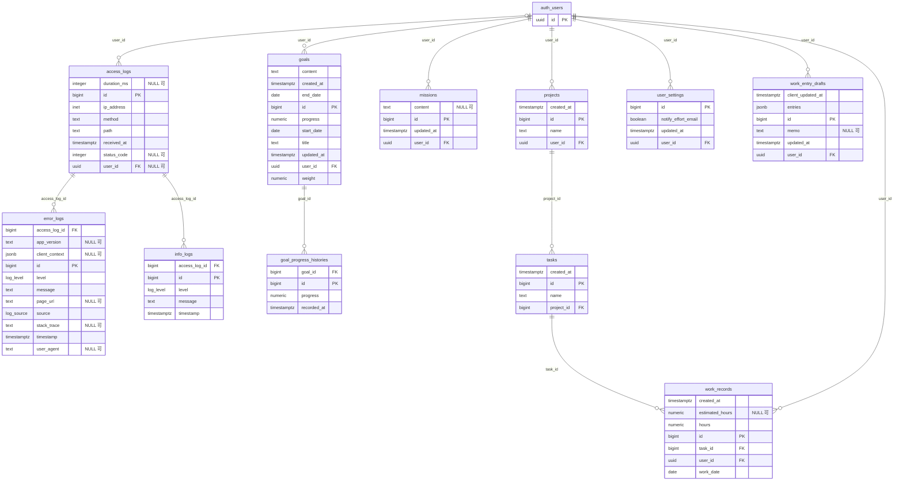

# テーブルの全体像

DB（Supabase の PostgreSQL、public スキーマ）のテーブルとビューの一覧と、その関係。

- **「テーブルの役割」は手書き**。テーブルを足したり役割が変わったりしたら、ここを直す
- **「ER 図」から下は自動生成**（`pnpm db:docs`）。生成型 `packages/shared/src/types/db.ts` と、`packages/api/supabase/migrations/` の主キー・外部キーから作る。スキーマを変えたら `pnpm db:types` を実行すれば、こちらも作り直される。ずれていると `pnpm harness:check`（CI）が失敗する
- 振る舞いや業務ルールは、各機能の仕様書（`docs/specs/<feature>/spec.md`）を正とする

## 前提

- バックエンドは **service role キーで接続する**ため、public スキーマのテーブルは RLS が有効でもポリシーは 0 個（ブラウザから直接は読み書きできない）。**すべてのクエリに `user_id` の条件を入れる**（`docs/steering/database.md`）
- ユーザーは Supabase Auth の `auth.users`。ユーザーを消すと、ほぼすべてのデータが連鎖して消える（`access_logs` だけは `user_id` が NULL になって残る）
- ストレージは `avatars` バケット（プロフィール画像。公開）。テーブルではないので下の図には出ない。**ここだけはブラウザから本人のトークンで直接読み書きする**ので、`storage.objects` のポリシーで本人のフォルダ（`<ユーザー ID>/`）だけに絞っている（`docs/specs/profile/spec.md` の INV-1）

## テーブルの役割

| テーブル / ビュー | 役割 | 主に使う機能 |
| --- | --- | --- |
| `projects` | 案件。ユーザーごとに名前が一意 | effort-entry、effort-list |
| `tasks` | 案件の中のタスク。案件ごとに名前が一意 | effort-entry、effort-list |
| `work_records` | 工数の実績（日付、時間、見積） | effort-entry、effort-list、weekly-report |
| `work_entry_drafts` | 工数登録の下書き。端末間で同期し、`client_updated_at` で競合を判定する（ユーザーごとに 1 行） | effort-draft |
| `goals` | 期間の目標（内容、重み、進捗） | goals、weekly-report |
| `goal_progress_histories` | 目標の進捗の履歴。週ごとの差分を出すのに使う | goals、weekly-report |
| `missions` | ミッション（ユーザーごとの自由記述）。週報の画面で編集する（週報の本文には入らない） | missions |
| `user_settings` | ユーザー設定（工数登録の完了メールを送るか） | user-settings、effort-entry |
| `access_logs` | API へのリクエストの記録。すべてのリクエストで 1 行書く | platform |
| `error_logs` | エラーの記録（API と UI の両方）。`access_log_id` でリクエストとたどれる | platform |
| `info_logs` | 情報レベルのログ | platform |
| `projects_with_tasks_mv`（マテリアライズドビュー） | 案件とタスクを結合した一覧。工数の登録で案件かタスクを新しく作ったときに `refresh_projects_with_tasks_mv()` で全体を作り直す。**一度も更新していないと読み出しがエラーになる** | effort-entry、effort-list |
| `work_record_diffs`（ビュー） | 工数の実績と見積の差 | effort-list |

<!-- BEGIN GENERATED: pnpm db:docs で作り直す。この間は手で編集しない -->

## ER 図

ビュー（`projects_with_tasks_mv`、`work_record_diffs`）は ER 図に含めない。列は下の「ビュー」を参照。

## テーブル

### access_logs

| 列 | 型 | NULL | 既定値 | キー | 参照先（削除時） |
| --- | --- | --- | --- | --- | --- |
| `duration_ms` | `integer` | 可 |  |  |  |
| `id` | `bigint` |  | `IDENTITY（常に自動）` | PK |  |
| `ip_address` | `inet` |  |  |  |  |
| `method` | `text` |  |  |  |  |
| `path` | `text` |  |  |  |  |
| `received_at` | `timestamptz` |  | `now()` |  |  |
| `status_code` | `integer` | 可 |  |  |  |
| `user_id` | `uuid` | 可 |  | FK | `auth.users.id`（SET NULL） |

### error_logs

| 列 | 型 | NULL | 既定値 | キー | 参照先（削除時） |
| --- | --- | --- | --- | --- | --- |
| `access_log_id` | `bigint` |  |  | FK | `access_logs.id`（CASCADE） |
| `app_version` | `text` | 可 |  |  |  |
| `client_context` | `jsonb` | 可 |  |  |  |
| `id` | `bigint` |  | `IDENTITY（常に自動）` | PK |  |
| `level` | `log_level` |  |  |  |  |
| `message` | `text` |  |  |  |  |
| `page_url` | `text` | 可 |  |  |  |
| `source` | `log_source` |  | `'API'` |  |  |
| `stack_trace` | `text` | 可 |  |  |  |
| `timestamp` | `timestamptz` |  | `now()` |  |  |
| `user_agent` | `text` | 可 |  |  |  |

### goal_progress_histories

| 列 | 型 | NULL | 既定値 | キー | 参照先（削除時） |
| --- | --- | --- | --- | --- | --- |
| `goal_id` | `bigint` |  |  | FK | `goals.id`（CASCADE） |
| `id` | `bigint` |  | `IDENTITY（常に自動）` | PK |  |
| `progress` | `numeric(5,2)` |  |  |  |  |
| `recorded_at` | `timestamptz` |  |  |  |  |

### goals

| 列 | 型 | NULL | 既定値 | キー | 参照先（削除時） |
| --- | --- | --- | --- | --- | --- |
| `content` | `text` |  |  |  |  |
| `created_at` | `timestamptz` |  | `now()` |  |  |
| `end_date` | `date` |  |  |  |  |
| `id` | `bigint` |  | `IDENTITY（常に自動）` | PK |  |
| `progress` | `numeric(5,2)` |  |  |  |  |
| `start_date` | `date` |  |  |  |  |
| `title` | `text` |  |  |  |  |
| `updated_at` | `timestamptz` |  | `now()` |  |  |
| `user_id` | `uuid` |  |  | FK | `auth.users.id`（CASCADE） |
| `weight` | `numeric(5,2)` |  |  |  |  |

### info_logs

| 列 | 型 | NULL | 既定値 | キー | 参照先（削除時） |
| --- | --- | --- | --- | --- | --- |
| `access_log_id` | `bigint` |  |  | FK | `access_logs.id`（CASCADE） |
| `id` | `bigint` |  | `IDENTITY（常に自動）` | PK |  |
| `level` | `log_level` |  |  |  |  |
| `message` | `text` |  |  |  |  |
| `timestamp` | `timestamptz` |  | `now()` |  |  |

### missions

| 列 | 型 | NULL | 既定値 | キー | 参照先（削除時） |
| --- | --- | --- | --- | --- | --- |
| `content` | `text` | 可 |  |  |  |
| `id` | `bigint` |  | `IDENTITY（常に自動）` | PK |  |
| `updated_at` | `timestamptz` |  | `now()` |  |  |
| `user_id` | `uuid` |  |  | FK | `auth.users.id`（CASCADE） |

### projects

| 列 | 型 | NULL | 既定値 | キー | 参照先（削除時） |
| --- | --- | --- | --- | --- | --- |
| `created_at` | `timestamptz` |  | `now()` |  |  |
| `id` | `bigint` |  | `IDENTITY（常に自動）` | PK |  |
| `name` | `text` |  |  |  |  |
| `user_id` | `uuid` |  |  | FK | `auth.users.id`（CASCADE） |

### tasks

| 列 | 型 | NULL | 既定値 | キー | 参照先（削除時） |
| --- | --- | --- | --- | --- | --- |
| `created_at` | `timestamptz` |  | `now()` |  |  |
| `id` | `bigint` |  | `IDENTITY（常に自動）` | PK |  |
| `name` | `text` |  |  |  |  |
| `project_id` | `bigint` |  |  | FK | `projects.id`（CASCADE） |

### user_settings

| 列 | 型 | NULL | 既定値 | キー | 参照先（削除時） |
| --- | --- | --- | --- | --- | --- |
| `id` | `bigint` |  | `IDENTITY（常に自動）` | PK |  |
| `notify_effort_email` | `boolean` |  | `true` |  |  |
| `updated_at` | `timestamptz` |  | `now()` |  |  |
| `user_id` | `uuid` |  |  | FK | `auth.users.id`（CASCADE） |

### work_entry_drafts

| 列 | 型 | NULL | 既定値 | キー | 参照先（削除時） |
| --- | --- | --- | --- | --- | --- |
| `client_updated_at` | `timestamptz` |  |  |  |  |
| `entries` | `jsonb` |  |  |  |  |
| `id` | `bigint` |  | `IDENTITY（常に自動）` | PK |  |
| `memo` | `text` | 可 |  |  |  |
| `updated_at` | `timestamptz` |  | `now()` |  |  |
| `user_id` | `uuid` |  |  | FK | `auth.users.id`（CASCADE） |

### work_records

| 列 | 型 | NULL | 既定値 | キー | 参照先（削除時） |
| --- | --- | --- | --- | --- | --- |
| `created_at` | `timestamptz` |  | `now()` |  |  |
| `estimated_hours` | `numeric(4,2)` | 可 |  |  |  |
| `hours` | `numeric(4,2)` |  |  |  |  |
| `id` | `bigint` |  | `IDENTITY（常に自動）` | PK |  |
| `task_id` | `bigint` |  |  | FK | `tasks.id`（CASCADE） |
| `user_id` | `uuid` |  |  | FK | `auth.users.id`（CASCADE） |
| `work_date` | `date` |  |  |  |  |

## ビュー

列の型は生成型（TypeScript）の型。ビューの列は、すべて NULL になりうるものとして生成される

### projects_with_tasks_mv

| 列 | 型 | NULL |
| --- | --- | --- |
| `project_created_at` | `string` | 可 |
| `project_id` | `number` | 可 |
| `project_name` | `string` | 可 |
| `task_created_at` | `string` | 可 |
| `task_id` | `number` | 可 |
| `task_name` | `string` | 可 |
| `user_id` | `string` | 可 |

### work_record_diffs

| 列 | 型 | NULL |
| --- | --- | --- |
| `created_at` | `string` | 可 |
| `estimated_hours` | `number` | 可 |
| `hours` | `number` | 可 |
| `hours_diff` | `number` | 可 |
| `id` | `number` | 可 |
| `project_id` | `number` | 可 |
| `project_name` | `string` | 可 |
| `task_id` | `number` | 可 |
| `task_name` | `string` | 可 |
| `user_id` | `string` | 可 |
| `work_date` | `string` | 可 |

## 関数

- `refresh_projects_with_tasks_mv`

## enum

- `log_level`: `DEBUG` / `INFO` / `WARNING` / `ERROR` / `CRITICAL`
- `log_source`: `API` / `UI`

<!-- END GENERATED -->
